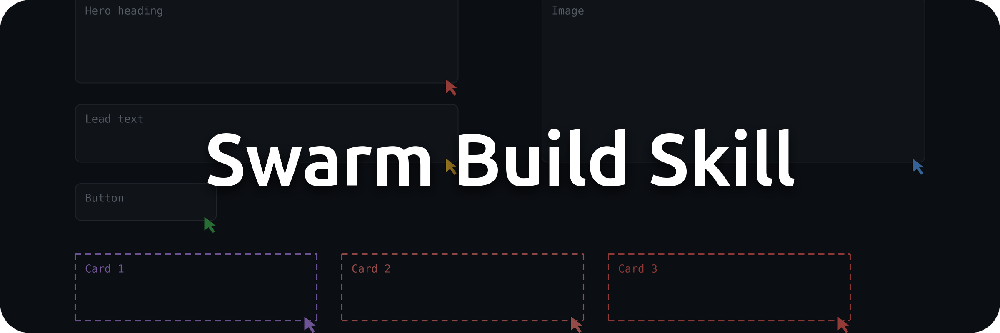

<div align="center">

<p align="center">
  
</p>

<p align="center"><a href="README.md">English</a> | <b>日本語</b></p>

<h1 align="center">Swarm Build Skill</h1>

<h3 align="center">カーソルの群れが、実物のページを少しずつ組み上げる動画を作ります。</h3>

<p align="center">色違いのカーソルが群れで動き、ページの実物に枠を描いて文字を打ち込みながら組み上げていく動画を、<a href="https://www.remotion.dev/">Remotion</a> で作る Claude Code 用スキルです。この演出を<b>スウォームビルド</b>と呼びます。</p>

<p align="center">
  <a href="https://github.com/Lapius7/swarm-build-skill/releases"></a>
  <a href="https://www.remotion.dev"></a>
  
  <a href="LICENSE"></a>
  <a href="https://github.com/Lapius7/swarm-build-skill/stargazers"></a>
  <a href="https://github.com/Lapius7/swarm-build-skill/commits/main"></a>
</p>

<p align="center"><a href="#使用例">使用例</a> · <a href="#導入">導入</a> · <a href="#手で使う">手で使う</a> · <a href="#buildpage-の引数">BuildPage の引数</a></p>

</div>

---

## 使用例

[vulns.lapius7.com](https://vulns.lapius7.com) の PV を、このスキルで作りました（画像をクリックすると mp4 を再生します）。

[](https://vulns.lapius7.com/pv.mp4)

## 特長

- Web ページを撮影し、要素の座標を取って、組み上がる動画にします。
- カーソルの数、カメラ、組み上がる順番を、場面ごとに変えられます。
- 動かせるテンプレートと撮影スクリプトを含みます。

### 動きの流れ

1. カーソルが要素に枠を描く
2. 枠の中に文字が打たれる
3. 枠が消え、要素だけが残る
4. 小さな要素は拡大してポンと出る
5. 担当を終えたカーソルは画面をうろついて薄れる

## 導入

```sh
curl -fsSL https://raw.githubusercontent.com/Lapius7/swarm-build-skill/main/install.sh | bash
```

`~/.claude/skills/swarm-build` に入ります。再実行すると更新します。`git` が要ります（`gh` があればそれで clone します）。

Claude Code で「このサイトのスウォームビルドのPVを作って」のように頼むと、スキルが使われます。

## 手で使う

```sh
cp -r template ~/projects/my-pv && cd ~/projects/my-pv
pnpm install
node scripts/capture.mjs home=https://example.com/   # 撮影と要素の座標
pnpm studio                                          # プレビュー
pnpm render                                          # out/pv.mp4
```

撮影には Chromium が要ります。Playwright で入れたものを自動で探し、見つからなければ `CHROME_PATH` で指定します。Remotion 自身の Chrome が起動しないときは `REMOTION_BROWSER` を指定します。

場面は `template/src/scenes.ts` で編集します。記入例は `references/scenes.example.ts` です。

## 構成

<details>
<summary>このリポジトリのファイル</summary>

| パス | 内容 |
|---|---|
| `SKILL.md` | スキル本体（演出の決まりと手順） |
| `template/` | そのまま動く Remotion プロジェクト |
| `template/src/Build.tsx` | 演出のエンジン（`BuildPage`） |
| `template/src/scenes.ts` | 場面の一覧。ここを編集する |
| `template/scripts/capture.mjs` | 画面を撮り、要素の座標を出す |
| `template/scripts/stills.mjs` | 場面ごとの静止画を書き出して確かめる |
| `CHANGELOG.md`、`VERSION` | 版の履歴（現在 1.0.0） |
| `references/tuning.md` | 長さ、音、ブラウザの調整メモ |
| `references/scenes.example.ts` | 場面の記入例（カメラ、カーソル数、順番の変え方） |

</details>

## BuildPage の引数

| 引数 | 役割 |
|---|---|
| `img`、`data` | 撮った画像と座標の JSON |
| `dur` | 場面の長さ（フレーム） |
| `cursors` | カーソルの数（12 まで） |
| `cam` | `s` 拡大率、`y` スクロール量、`x` 横のずれ。開始と終了の 2 値 |
| `buildStart`、`buildEnd` | 組み上げの開始と終了のフレーム |
| `order` | `y`、`x`、`center` |
| `outline` | `box`、`dashed`、`underline` |

## 安全のために

> [!WARNING]
> 撮る相手は、自分のサイトか撮影を許可されたものに限ります。

> [!NOTE]
> 作者が確かめたこと: `template/` の型検査（`tsc`）が通ること、撮影から静止画の書き出しまで通ること（`capture.mjs` で撮影し、`remotion still` で組み上げ中の場面を表示）。動画（mp4）の再生は確かめていません。

## 版

[Releases](https://github.com/Lapius7/swarm-build-skill/releases) で版を管理しています。現在 1.0.0。履歴は `CHANGELOG.md` にあります。

## ライセンス

[MIT](LICENSE)
