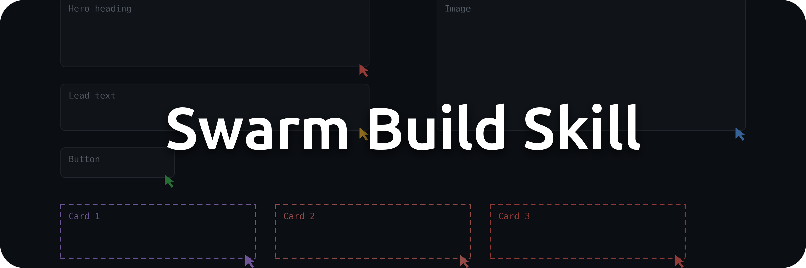

<div align="center">

<p align="center">
  
</p>

<p align="center"><b>English</b> | <a href="README.ja.md">日本語</a></p>

<h1 align="center">Swarm Build Skill</h1>

<h3 align="center">Videos where cursors swarm over a real page and build it piece by piece.</h3>

<p align="center">A Claude Code skill that makes <a href="https://www.remotion.dev/">Remotion</a> videos in which multi-coloured cursors draw a box around each element of a real web page, type its text inside, and build the page up. The effect is called <b>Swarm Build</b>.</p>

<p align="center">
  <a href="https://github.com/Lapius7/swarm-build-skill/releases"></a>
  <a href="https://www.remotion.dev"></a>
  
  <a href="LICENSE"></a>
  <a href="https://github.com/Lapius7/swarm-build-skill/stargazers"></a>
  <a href="https://github.com/Lapius7/swarm-build-skill/commits/main"></a>
</p>

<p align="center"><a href="#example">Example</a> · <a href="#install">Install</a> · <a href="#use-it-by-hand">Use it by hand</a> · <a href="#buildpage-props">Props</a></p>

</div>

---

## Example

The PV for [vulns.lapius7.com](https://vulns.lapius7.com), made with this skill (click the image to play the mp4).

[](https://vulns.lapius7.com/pv.mp4)

## Features

- Captures a web page, takes the coordinates of its elements and turns them into a build-up video.
- Changes the number of cursors, the camera and the build order for each scene.
- Includes a runnable template and a capture script.

### How it looks

1. A cursor draws a box around an element.
2. Text is typed inside the box.
3. The box fades, leaving the element.
4. Small elements (under 56px) pop in with a scale overshoot.
5. Cursors that finish wander around and fade out.

## Install

```sh
curl -fsSL https://raw.githubusercontent.com/Lapius7/swarm-build-skill/main/install.sh | bash
```

This clones the repo to `~/.claude/skills/swarm-build`. Run it again to update. Requires `git` (uses `gh` if present).

Then ask Claude Code, for example: "Make a Swarm Build promo video for this site."

## Use it by hand

```sh
cp -r template ~/projects/my-pv && cd ~/projects/my-pv
pnpm install
node scripts/capture.mjs home=https://example.com/   # screenshot + element boxes
pnpm studio                                          # preview
pnpm render                                          # out/pv.mp4
```

Capture needs Chromium: it looks in the Playwright cache, or set `CHROME_PATH`. If Remotion's own Chrome will not start, set `REMOTION_BROWSER`.

Edit `template/src/scenes.ts` to arrange scenes. See `references/scenes.example.ts`.

## Layout

<details>
<summary>Files in this repository</summary>

| Path | What it is |
|---|---|
| `SKILL.md` | The skill itself (rules for the effect and the steps) |
| `template/` | A runnable Remotion project |
| `template/src/Build.tsx` | The effect engine (`BuildPage`) |
| `template/src/scenes.ts` | The scene list. Edit this |
| `template/scripts/capture.mjs` | Captures the page and outputs element coordinates |
| `template/scripts/stills.mjs` | Writes stills per scene to check the result |
| `CHANGELOG.md`, `VERSION` | Version history (currently 1.0.0) |
| `references/tuning.md` | Notes on length, sound and the browser |
| `references/scenes.example.ts` | Scene examples (camera, cursor count, order) |

</details>

## BuildPage props

| Prop | Meaning |
|---|---|
| `img`, `data` | Screenshot and its element-box JSON |
| `dur` | Scene length in frames |
| `cursors` | Number of cursors (max 12) |
| `cam` | `s` scale, `y` scroll, `x` shift; each is a `[start, end]` pair |
| `buildStart`, `buildEnd` | Frames where building starts and ends |
| `order` | `y` (top-down), `x` (left columns first), `center` (outward) |
| `outline` | `box`, `dashed`, `underline` |

## Safety

> [!WARNING]
> Only capture pages you own or have permission to record.

> [!NOTE]
> Verified by the author: the template type-checks, and capture and still rendering work end to end. Playback of the rendered mp4 has not been checked. `SKILL.md` is written in Japanese.

## Versions

Versions are managed on [Releases](https://github.com/Lapius7/swarm-build-skill/releases). The current version is 1.0.0. See `CHANGELOG.md` for the history.

## License

[MIT](LICENSE)
